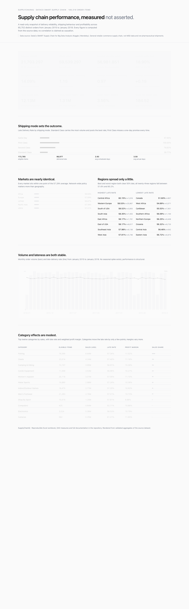

# SupplyChainIQ - Healthcare-Oriented Supply Chain Analytics

A portfolio-ready, end-to-end supply chain analytics project built on the real
**DataCo SMART Supply Chain** dataset. It demonstrates data inspection and cleaning,
KPI engineering, Excel analytics, a documented Power BI data model and DAX measures,
and evidence-backed business findings.

> Scope note: this is a general retail/e-commerce supply chain dataset. It is not MSD
> data and contains no pharmaceutical shipments. It is presented as a supply chain
> analytics case study with relevance to healthcare operations analytics.

## Business problem

Supply chain teams need to know how reliably orders are fulfilled, whether actual
shipping times meet scheduled commitments, and which shipping modes, regions,
categories or periods are associated with poor performance.

Question set: see `docs/business_insights.md` and `docs/dashboard_design.md`.

## Dataset

- DataCo SMART Supply Chain for Big Data Analysis
- Kaggle: https://www.kaggle.com/datasets/shashwatwork/dataco-smart-supply-chain-for-big-data-analysis
- Data dictionary (source): `data/raw/DescriptionDataCoSupplyChain.csv`
- Profile: 180,519 order-item rows, 53 original columns, 2015-01 to 2018-01,
  65,752 distinct orders, 20,652 distinct customers, 118 distinct products.

The raw CSV (91 MB) is gitignored. Download it into `data/raw/`.

## Tools

Microsoft Excel, Power BI Desktop, Power Query, DAX, Git/GitHub (Python with pandas
optional; this build used the standard library plus openpyxl).

## Repository structure

    supplychainiq/
    ├── README.md
    ├── LICENSE
    ├── LICENSE-NOTES.md
    ├── CITATION.cff
    ├── CHANGELOG.md
    ├── requirements.txt
    ├── .gitignore
    ├── .gitattributes
    ├── .editorconfig
    ├── .github/workflows/ci.yml
    ├── dashboard/index.html
    ├── data/raw/README.md                  (CSV extract is gitignored)
    ├── data/processed/README.md            (cleaned CSV is gitignored)
    ├── docs/
    │   ├── business_insights.md
    │   ├── dashboard_design.md
    │   ├── data_dictionary.md
    │   ├── data_quality_report.md
    │   ├── methodology.md
    │   ├── relational_model_reference.md
    │   └── reproducibility.md
    ├── excel/supply_chain_analysis.xlsx
    ├── powerbi/
    │   ├── data_model.md
    │   ├── dax/measures.dax
    │   ├── SupplyChainIQ.pbip              (open this in Power BI Desktop)
    │   ├── SupplyChainIQ.SemanticModel/    (TMDL: 6 tables, 16 measures)
    │   └── SupplyChainIQ.Report/           (PBIR: 4 pages, 30 visuals)
    ├── screenshots/dashboard.png
    └── scripts/
        ├── build_excel_workbook.py
        ├── inspect_data.py
        ├── prepare_cleaned_data.py
        └── validate_data.py

## Setup

1. Download `DataCoSupplyChainDataset.csv` and `DescriptionDataCoSupplyChain.csv`
   from Kaggle into `data/raw/`.
2. Install the single third-party dependency:

       python -m pip install -r requirements.txt

3. Run `python3 scripts/prepare_cleaned_data.py` to build the cleaned CSV.
4. Run `python3 scripts/validate_data.py` to check integrity.
5. Open `excel/supply_chain_analysis.xlsx` (already contains the cleaned table
   and validated summaries).

Full command order and expected validation figures: `docs/reproducibility.md`.

Power BI Desktop: https://www.microsoft.com/en-us/download/details.aspx?id=58494

For Power BI, build the model following `docs/dashboard_design.md` and load the
measures from `powerbi/dax/measures.dax`.

## Workbook

Sheets: Read Me, Data Dictionary, Cleaned Data (Excel Table `CleanedData`),
Delivery Analysis, Pivot Setup, KPI Summary.

## KPIs

Distinct Orders; Order Items; Eligible Delivery Records; Late Delivery Records;
Late Delivery Rate (57.29%); On-Time Delivery Rate; Average Actual/Scheduled
Shipping Days; Average Shipping Delay; Total Sales (36.8M USD); Total Order Profit
(4.0M USD); Order Profit Margin (10.78%); Sales per Order.

## Dashboard pages (Power BI spec)

1. Executive Overview
2. Shipping Performance
3. Geography and Product Analysis
4. Business Performance and Insights

Full layout: `docs/dashboard_design.md`.

## Headline findings

1. 57.29% of eligible order items are delivered late.
2. First Class has a 100.00% late rate against a one-day promise; Standard Class
   has the best late rate (39.77%) at the largest volume.
3. Markets (56.8-57.7%) and regions (51.6-60.2%) are nearly level; mode policy
   explains more than geography.
4. Monthly late rate is stable around 57% with no seasonal spike.
5. Product categories and customer segments barely move the late rate (52.7-62.6%).
6. Total sales 36.8M USD; weighted margin 10.78%.

Full treatment: `docs/business_insights.md`.
## Interactive dashboard (bonus)

A dependency-free, single-file HTML dashboard with animated KPIs and charts lives at
`dashboard/index.html`. Open it directly in any browser. It renders the validated
aggregates above with a restrained, low-chrome interface. No external libraries,
icons or stock imagery.

## Dashboard preview

The capture is the dependency-free HTML dashboard (`dashboard/index.html`) rendered in Chrome.

## Limitations

- No genuine supplier/master data; no supplier scorecard or freight costs.
- No cause is claimed from correlation.
- No prediction model; descriptive analytics only.
- The Power BI semantic model and report are authored as a **Power BI Project**
  (`powerbi/SupplyChainIQ.pbip`, TMDL + PBIR) rather than a binary `.pbix`, so
  every table, measure, page and visual is reviewable in source control. The
  `.pbix` itself is gitignored and is produced by opening the project and
  saving. Excel PivotTable objects are not generated programmatically; the
  specification is in the `Pivot Setup` sheet.

## Reproducibility

See `docs/reproducibility.md` for the exact command order, the validation
figures a correct run must produce, and why the pipeline is deterministic.
`docs/methodology.md` covers the analytical decisions behind each step.

Scripts are standard-library Python plus `openpyxl`, declared in
`requirements.txt`. CI byte-compiles them on every push and fails the build if
a CSV extract is ever committed.

## Screenshots

`screenshots/dashboard.png` is the dependency-free HTML dashboard rendered in
Chrome.

**Outstanding:** export one PNG per page from `powerbi/SupplyChainIQ.pbip`
(Executive Overview, Shipping Performance, Geography and Product Analysis,
Business Performance and Insights) and add them here. This is the only open
item in the repository.

## Licence

Code, documentation and the workbook build script are released under the
[MIT Licence](LICENSE). The underlying DataCo dataset is **not** redistributed
here and remains subject to its own terms - see `LICENSE-NOTES.md`.

## Changelog

See [CHANGELOG.md](CHANGELOG.md).

## Citing

If you use this analysis, `CITATION.cff` carries ready-to-use citation
metadata, and GitHub renders it on the repository landing page.
